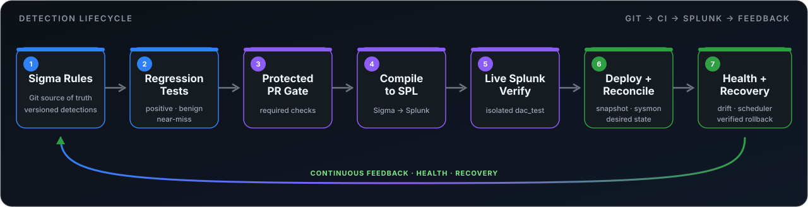

  

<h1 align="center">Detection-as-Code Pipeline</h1>

<strong>Sigma · GitHub Actions · Splunk Enterprise · Detection Lifecycle</strong>

  
  
  
  

Evidence-backed Sigma detections are tested, compiled to SPL, verified against live Splunk, deployed from protected Git, monitored for drift, and recoverable by snapshot rollback.

  <a href="#pipeline">Pipeline</a> ·
  <a href="#overview">Overview</a> ·
  <a href="#coverage">Coverage</a> ·
  <a href="#repository-guide">Repository Guide</a> ·
  <a href="#documentation">Documentation</a>

---

## Pipeline

  

Git defines the active detection state. Managed searches removed from Git are disabled in Splunk rather than deleted.

## Overview

This project turns detection engineering into a controlled CI/CD workflow. Sigma rules and test fixtures live in Git, pull requests run validation and regression tests, passing rules compile to Splunk SPL, and the generated searches are executed against an isolated live Splunk test index before deployment.

After verification, the pipeline snapshots the current managed state, deploys and reconciles detections through the Splunk REST API, then monitors the live searches for scheduling, version drift, query drift, and execution health. Recovery is manual and snapshot-based so changes remain traceable and reversible.

## Coverage

| Detections | Event corpora | Rule/corpus expectations | Investigation sources |
|---:|---:|---:|---:|
| 9 | 13 | 117 | 2 |

Rules are derived from the [Agent Tesla malware analysis](https://github.com/bran-dot-flake/Agent-Tesla-Malware-Analysis-and-Detection-Engineering) and [Threat Hunting with Splunk](https://github.com/bran-dot-flake/Threat-Hunting-with-Splunk-Hack-The-Box-Writeup).

## Core controls

| Stage | Control |
|---|---|
| Test | Positive, benign, and near-miss fixtures with a complete expectation matrix |
| Promote | Protected `main` branch with required CI checks |
| Verify | Compiled SPL executed against isolated `dac_test` data in live Splunk |
| Deploy | Idempotent REST deployment with pre-deploy snapshot and desired-state reconciliation |
| Monitor | Scheduled health checks for execution state, version drift, and SPL drift |
| Recover | Manual, verified rollback from retained deployment snapshots |

Pull-request code runs only on GitHub-hosted runners. Private Splunk access occurs only after trusted promotion to `main`.

## Repository Guide

| Resource | Purpose |
|---|---|
| [`rules/sigma/`](rules/sigma/) | Sigma detections |
| [`tests/sample-logs/`](tests/sample-logs/) | Positive, benign, and near-miss fixtures |
| [`ci/expectations.yml`](ci/expectations.yml) | Complete expected-match matrix |
| [`scripts/`](scripts/) | Build, integration, deployment, health, snapshot, and rollback tooling |
| [`.github/workflows/`](.github/workflows/) | CI/CD, health, rollback, and release workflows |
| [`docs/`](docs/) | Focused implementation and operations notes |

## Documentation

[Detections](docs/DETECTIONS.md) · [Testing](docs/TESTING.md) · [Operations & Recovery](docs/OPERATIONS.md) · [Contributing](CONTRIBUTING.md)
